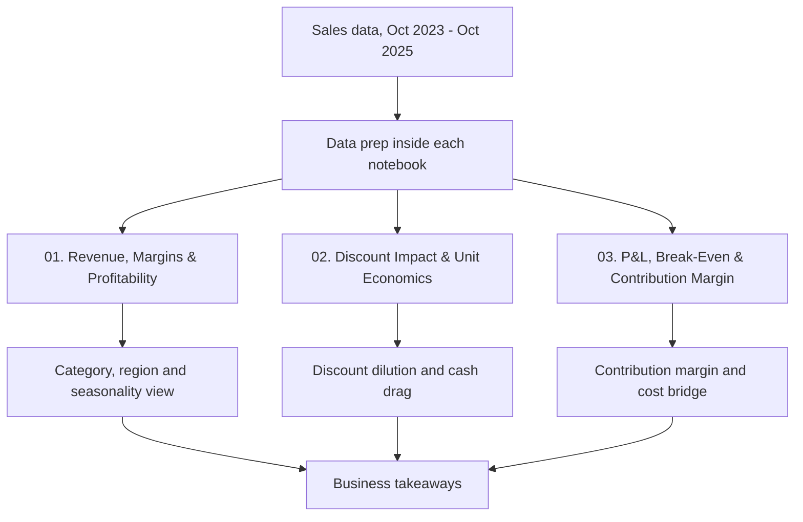
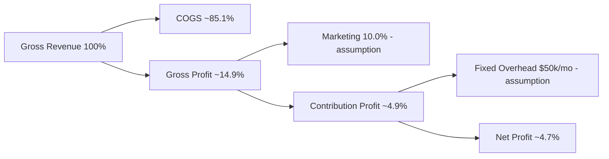

📊 E-Commerce Commercial & Financial Analytics Suite
An end-to-end analytics project covering exploratory data analysis (EDA), promotional unit economics and P&L decomposition for an e-commerce portfolio, built on a simulated sales dataset of 5,000 orders.
---
🏗️ Analytics Pipeline

Data prep (date parsing, COGS derivation, missing-value check) happens at the top of each notebook; there is no separate cleaning script.
🧭 Margin Flow (notebook 03 cost model)

📈 Key Findings
Figures cover the complete months in the data (notebooks 01 and 03 exclude October 2025, which has only 3 days of orders).
Notebook 01: Revenue, Margins & Profitability
Even category mix: gross margins range from 14.2% (Beauty) to 15.4% (Furniture), and no category exceeds 10.7% of revenue.
No pronounced seasonality: quarterly revenue shares are 23.8% - 25.8%; Q4 (25.3%) is not a peak.
Balanced regions: North is the largest at 26.9% of revenue and South the smallest at 23.1%; regional margins differ by less than 0.4 percentage points.
Notebook 02: Discount Impact & Unit Economics
Margin illusion: gross margin % stays around 14.7% - 15.2% in every discount tier, but profit per unit falls by 20.28% at the 20% tier ($5,893.04 to $4,698.04).
No consistent volume response: units sold versus the 0% tier are +2.9%, +5.8%, -1.5% and +3.5% for the 5%, 10%, 15% and 20% tiers. The 20% tier would need about +25.4% more volume to offset its lower profit per unit.
Notebook 03: P&L, Break-Even & Contribution Margin
Thin margins: gross margin is about 14.9%; with the assumed 10% marketing rate the contribution margin is about 4.9% and the net margin about 4.7%.
Break-even revenue: about $0.89M - $1.12M per month against average monthly sales of about $22.2M, because the assumed $50k fixed overhead is only about 0.2% of revenue.
Marketing guardrail: net profit turns negative at a marketing rate of about 14.7% of sales (14.2% - 15.4% by month). The 10% rate is a benchmark assumption, not a hard limit.
> Marketing (10% of sales) and fixed overhead ($50k/month) are modelling assumptions, not values from the dataset. Change `MARKETING_RATE` and `MONTHLY_FIXED_COST` in notebook 03 to test other scenarios.
🛠️ Project Structure
```
├── data/
│   └── Ecommerce_Sales_Data_2024_2025.csv
├── notebooks/
│   ├── e_commerce_profilability_pl_analysis.ipynb   # 01. Revenue, Margins & Profitability
│   ├── discount.ipynb                               # 02. Discount Impact & Unit Economics
│   └── P_L.ipynb                                    # 03. P&L, Break-Even & Contribution Margin
├── app.py                                           # Dash dashboard
└── README.md
```
🗂️ Data
`data/Ecommerce_Sales_Data_2024_2025.csv` contains 5,000 orders placed between 4 October 2023 and 3 October 2025 (the last month holds only 3 days).
Column	Description
Order ID, Order Date	Unique order number and date (`MM/DD/YY`)
Customer Name, Region, City	Customer and location
Category, Sub-Category, Product Name	Product hierarchy
Quantity, Unit Price, Discount	Units, list price and discount in % (0, 5, 10, 15 or 20)
Sales, Profit	Net revenue after discount and gross profit per order
Payment Mode	Payment method
Amounts are shown with a `$` sign in the notebooks. COGS is derived as `Sales - Profit`.
🚀 Getting Started
```bash
git clone https://github.com/KuzevaStasy/E-commerce-Profitability-P-L-Analysis.git
cd E-commerce-Profitability-P-L-Analysis
pip install pandas numpy matplotlib seaborn jupyter
jupyter notebook notebooks/
```
The notebooks find the data file automatically when run from the repository root or from the `notebooks/` folder. In Google Colab, clone the repository first so that `data/` is available.
Dashboard
```bash
pip install dash plotly pandas
python app.py
```
Then open http://127.0.0.1:8050. The dashboard has a category filter, KPI cards (revenue, profit, margin %) and three charts: revenue vs profit trend, discount impact on margin and a monthly P&L overview.
💻 Tech Stack
Python 3.10+
Data: pandas, numpy
Visualization: matplotlib, seaborn (notebooks); Dash, plotly (dashboard)
Environment: Jupyter Notebooks
